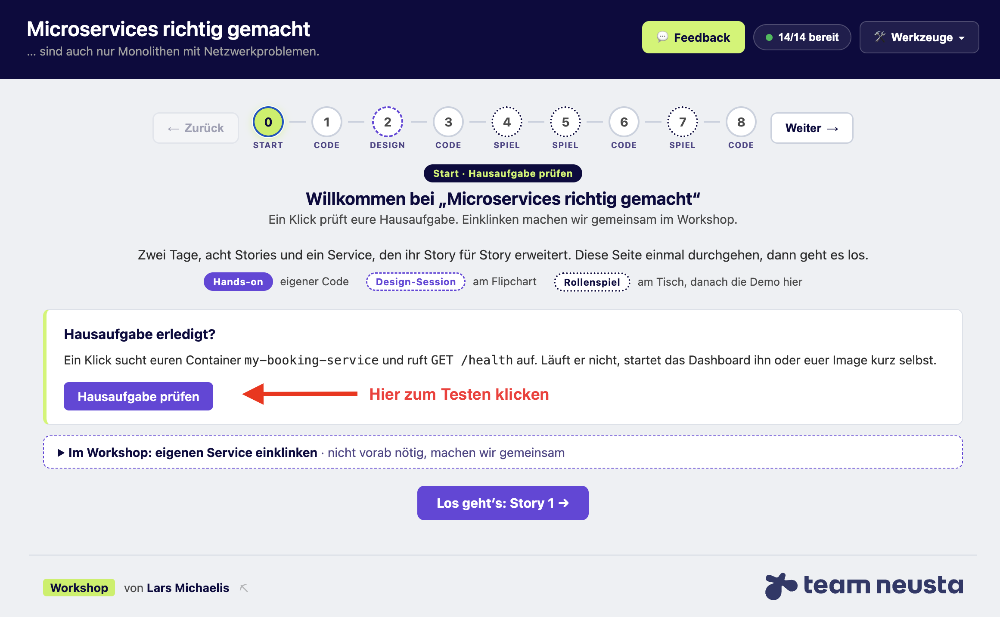

# Workshop-Vorbereitung

Diese Vorbereitung ist **Pflicht** und wird **vor** dem Workshop-Termin erledigt. Aufwand: ca. 1 bis 2 Stunden. Sie stellt sicher, dass wir am Workshop-Tag direkt mit den Inhalten starten, statt Setup-Probleme zu lösen.

> Erledige die Schritte 1 bis 3 möglichst **in dem Netz, in dem du auch am Workshop-Tag arbeitest** (Firmen-WLAN, VPN). Firmen-Proxies und TLS-Zertifikate fallen sonst erst am Workshop-Tag auf, besonders unter Windows/WSL2.

## Voraussetzungen

<!-- schritt: Voraussetzungen -->

- **Git**
- **Docker** inkl. Docker Compose (harte Voraussetzung, ohne läuft die Workshop-Umgebung nicht)
- **IDE / Editor** nach Wahl
- **jq** (empfohlen für Story 8, zum Filtern der JSON-Logs; ohne jq geht es auch mit `grep`)
- Eine Sprache bzw. ein Framework deiner Wahl für deinen Mini-Service (Java/Spring Boot, Quarkus, Go, Node.js, ...)
- Du kannst darin ein neues Projekt aufsetzen, das einen HTTP-Endpoint bereitstellt und per Dockerfile ein Image baut. Genau das ist die Pflicht-Hausaufgabe in Abschnitt 1. Im Workshop selbst üben wir das nicht.

## 1. Eigenen Mini-Service bauen (Pflicht-Hausaufgabe)

<!-- schritt: Hausaufgabe -->

Setze in deiner Sprache/deinem Framework ein neues, leeres Projekt auf. Diesen Mini-Service erweiterst du im Workshop in einem Team, Story für Story. Das Einbinden in die Workshop-Umgebung („Einklinken“) machen wir gemeinsam im Workshop.

Akzeptanzkriterien:

- [ ] Neues Projekt in deiner Sprache/deinem Framework
- [ ] `GET /health` antwortet mit HTTP 200
- [ ] Eine `Dockerfile` liegt im Projekt, `docker build` läuft fehlerfrei durch
- [ ] Der Container startet, dein Service lauscht darin auf Port `8080`
- [ ] Der Code liegt in einem Git-Repository, das du im Workshop mit deinem Team teilen kannst

> **Mehr nicht**
> Ein leeres HTTP 200 genügt, Body und Format sind egal. Alles Weitere kommt im Workshop.

> **Repository für dein Team**
> - Im Workshop einigt sich jedes Team auf einen der mitgebrachten Services, die anderen klonen ihn.
> - Ort egal: GitHub, GitLab, Bitbucket oder das Git deiner Firma.
> - Privat ist ok, wenn du andere einladen kannst.
> - Keine Passwörter oder internen Daten.

Smoke-Test:

```bash
docker build -t my-booking-service .
docker run --rm -p 8099:8080 my-booking-service

# zweites Terminal:
curl -i http://localhost:8099/health   # erwartet: HTTP/1.1 200
```

Unter `localhost:8099` ist dein Service auch später im Workshop erreichbar. Im Container bleibt es Port `8080`.

Danach den Container mit Ctrl+C stoppen, denn den Host-Port `8099` belegt gleich die Workshop-Umgebung. Zeigt `docker ps` ihn noch, mit `docker stop <id>` stoppen. Das Image bleibt erhalten, das Dashboard prüft es in Schritt 3. Der Name `my-booking-service` ist nicht Pflicht. Mit diesem Namen findet das Dashboard dein Image aber automatisch, sonst wählst du es aus einer Liste aus.

> **Klappt nicht?**
> - [Port belegt (Adresse bereits in Verwendung)](troubleshooting.md#port-belegt-adresse-bereits-in-verwendung)
> - [Nur Windows/WSL2: Zertifikatsfehler beim `git clone` oder Build](troubleshooting.md#nur-windowswsl2-zertifikatsfehler-beim-git-clone-oder-build)

## 2. Workshop-Umgebung starten

<!-- schritt: Umgebung -->

> **Windows:** Klone das Repo in das WSL2-Dateisystem (z. B. `~/projects/...`, nicht `/mnt/c/...`). Die `.env` muss LF-Zeilenenden haben, nicht CRLF.

```bash
git clone https://github.com/larmic/workshop_microservices.git
cd workshop_microservices/services
cp .env.example .env
make docker-up-hub
```

Das zieht fertige Images von Docker Hub und startet alle Container. Die `.env` funktioniert so, wie sie ist. Falls `make` nicht verfügbar ist:

```bash
docker compose -f docker-compose.yml -f docker-compose.infra.yml \
  -f docker-compose.reference.yml pull

docker compose -f docker-compose.yml -f docker-compose.infra.yml \
  -f docker-compose.reference.yml -f docker-compose.custom.yml build booking-custom

docker compose -f docker-compose.yml -f docker-compose.infra.yml \
  -f docker-compose.reference.yml -f docker-compose.custom.yml up
```

Erledigt, wenn:

- [ ] Repo geklont, `.env` angelegt
- [ ] Der Stack läuft ohne Fehler

> **Klappt nicht?**
> - [Port belegt (Adresse bereits in Verwendung)](troubleshooting.md#port-belegt-adresse-bereits-in-verwendung)
> - [Image-Pull schlägt fehl](troubleshooting.md#image-pull-schlägt-fehl)
> - [Nur Windows/WSL2: Zertifikatsfehler beim `git clone` oder Build](troubleshooting.md#nur-windowswsl2-zertifikatsfehler-beim-git-clone-oder-build)

## 3. Hausaufgabe prüfen

<!-- schritt: Prüfen -->

Öffne das Dashboard unter <http://localhost> und klicke auf der Startseite auf **Hausaufgabe prüfen**.

Erfolgreich vorbereitet bist du, wenn:

- [ ] Das **Dashboard** unter <http://localhost> lädt
- [ ] Auf der Startseite des Dashboards zeigt **Hausaufgabe prüfen** ein grünes Ergebnis. Das Dashboard findet deinen Container oder dein Image selbst und startet es bei Bedarf kurz.

> **Gut zu wissen**
> Im Dashboard und im Repo siehst du schon alle Stories und die Referenz-Lösungen. Schau sie dir bitte nicht vorab an: Die Stories lösen wir im Workshop gemeinsam im Team, und das macht ohne Vorwissen deutlich mehr Spaß. Mit der Hausaufgabe und einem grünen Check bist du fertig.



> **Klappt nicht?**
> - [„Hausaufgabe prüfen“ wird rot](troubleshooting.md#hausaufgabe-prüfen-wird-rot)
> - [Dashboard / `http://localhost` lädt nicht](troubleshooting.md#dashboard--httplocalhost-lädt-nicht)
> - [Nur Windows/WSL2: `http://localhost` nicht erreichbar, obwohl alle Container laufen](troubleshooting.md#nur-windowswsl2-httplocalhost-nicht-erreichbar-obwohl-alle-container-laufen)

Das war's. Alles Weitere machen wir gemeinsam im Workshop.

## Bei Problemen

Wenn etwas hakt und die Hilfe zu den Schritten nicht weiterhilft: melde dich **vor** dem Workshop kurz per Mail oder Chat beim Trainer. Am Workshop-Tag selbst bleibt für Setup-Probleme wenig Zeit.
